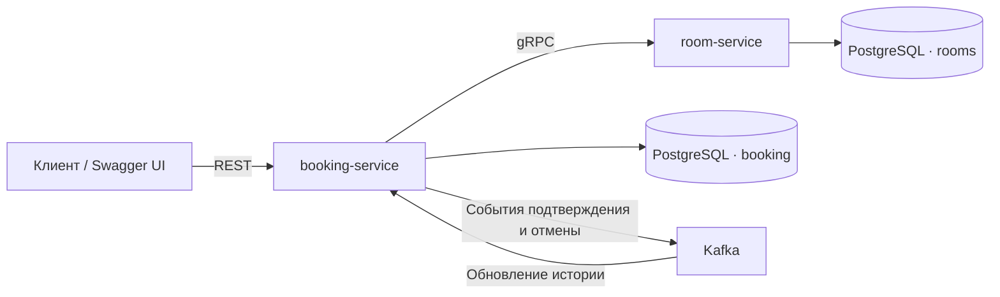

# Сервис бронирования аудиторий и переговорок

Backend лабораторной № 2 на Kotlin и Spring Boot. Через REST API можно управлять помещениями, бронировать их, смотреть расписание на дату, отменять брони и читать историю. Каталог и бронирования работают в отдельных сервисах и базах PostgreSQL. Сервисы общаются по gRPC, а история обновляется из событий Kafka.

- [Запуск](#запуск)
- [Микросервисы](#микросервисы)
- [REST API](#rest-api)
- [Переменные окружения](#переменные-окружения)
- [Схема PostgreSQL](#схема-postgresql)
- [Команды и тесты](#команды-и-тесты)

## Запуск

Нужны `make` и запущенный Docker с Docker Compose. Выполни из корня проекта:

```bash
make run
```

Команда собирает образы обоих приложений, запускает PostgreSQL и Kafka и ждёт готовности контейнеров. При первом запуске PostgreSQL создаёт базы `rooms` и `booking` и отдельную роль для каждого приложения. Flyway применяет миграции при запуске сервисов. `make down` останавливает backend с сохранением данных PostgreSQL и Kafka.

- Swagger UI для ручной проверки запросов. [Открыть Swagger UI](http://localhost:8080/swagger-ui/index.html)
- Спецификация OpenAPI в JSON. [Открыть спецификацию](http://localhost:8080/v3/api-docs)
- Корневой адрес REST API при настройках по умолчанию. [Получить список помещений](http://localhost:8080/api/rooms)

В Swagger выбери операцию, нажми **Try it out**, заполни параметры и нажми **Execute**. Чтобы пройти весь сценарий, создай помещение через `POST /api/rooms`, подставь полученный `id` в `roomId` при вызове `POST /api/bookings`, затем открой расписание или историю. После отмены брони через `DELETE /api/bookings/{id}` история покажет статус `CANCELLED`, когда обработчик получит событие Kafka.

## Микросервисы

| Компонент | За что отвечает | Интерфейсы и данные |
| --- | --- | --- |
| `booking-service` | Принимает все REST-запросы. Проверяет доступность помещения и пересечения по времени, хранит действующие брони, строит расписание, координирует удаление помещений и ведёт историю | REST и Swagger на порту контейнера `8080`, исходящие gRPC-вызовы к `room-service`, база `booking`, публикация и потребление событий Kafka |
| `room-service` | Владеет каталогом помещений. Возвращает список и карточку помещения, создаёт, обновляет и удаляет записи каталога | Внутренний gRPC на `room-service:9090`, база `rooms` |
| `contracts` | Содержит исходный Protobuf-контракт и общие Kotlin-типы. Gradle генерирует gRPC-клиент и серверные интерфейсы при сборке | Библиотека Gradle без отдельного процесса и контейнера. [Контракт RoomCatalog](contracts/src/main/proto/rooms.proto) |



### Внутренний gRPC

Все RPC входят в сервис `booking.rooms.v1.RoomCatalog`. `RoomData` содержит `name`, `capacity` и `description`. `RoomDetails` содержит `id` и вложенный `RoomData`.

| RPC | Запрос | Ответ |
| --- | --- | --- |
| `ListRooms` | Пустое сообщение | `ListRoomsResponse` со списком `RoomDetails` |
| `GetRoom` | `RoomId` с `id` | `RoomDetails` |
| `CreateRoom` | `RoomData` | `RoomDetails` с новым `id` |
| `UpdateRoom` | `UpdateRoomRequest` с `id` и `data` | Обновлённый `RoomDetails` |
| `DeleteRoom` | `RoomId` с `id` | Пустое сообщение. Повторное удаление того же ID успешно |

По умолчанию дедлайн одной попытки равен 1000 мс. При `UNAVAILABLE` или `DEADLINE_EXCEEDED` клиент делает одну повторную попытку для `ListRooms`, `GetRoom` и идемпотентного `DeleteRoom`.

### Бронирование, Kafka и удаление помещений

1. При создании брони `booking-service` проверяет входные поля и ищет помещение по gRPC. Затем берёт транзакционную блокировку по ID помещения в базе `booking`, проверяет пересечения и записывает бронь.
2. Создание и отмена сохраняют событие в `booking_outbox` через JDBC в той же транзакции, что и изменение брони. Фоновая корутина читает ожидающие события через R2DBC как `Flow`, порциями до 32 записей по возрастанию ID. Она отправляет их в `booking-events-v1` с ID брони в качестве ключа и удаляет каждую запись через R2DBC после подтверждения Kafka. При недоступности Kafka события остаются в БД и отправляются позже.
3. Kafka-обработчик из группы `booking-history-v1` обновляет `booking_history`. Повторная доставка безопасна, а опоздавшее подтверждение не меняет статус `CANCELLED`. Некорректный JSON события направляется в `booking-events-v1.DLT`.
4. Удаление помещения использует ту же блокировку, что и создание брони. Если у помещения есть записи в `bookings`, API возвращает `409`. Иначе сервис сначала сохраняет отметку в `room_deletions`, затем удаляет помещение по gRPC. При сбое после записи отметки фоновая корутина завершает удаление после восстановления связи.

При остановке REST и gRPC дают активным запросам время завершиться. Фоновые задачи заканчивают текущую работу в пределах окна остановки, а незавершённая публикация или обработка продолжается из PostgreSQL либо Kafka после перезапуска.

## REST API

Базовый адрес по умолчанию — `http://localhost:8080`. Для запросов с телом передавай `Content-Type: application/json`. Имена полей чувствительны к регистру. Неизвестные поля JSON отклоняются. Успешные запросы на создание возвращают `201` и заголовок `Location` с путём к ресурсу, а запросы на удаление и отмену возвращают `204` с пустым телом.

### Помещения

| Метод и путь | Что принимает | Что возвращает | Ошибки операции |
| --- | --- | --- | --- |
| `GET /api/rooms` | Без параметров и тела | `200` и массив [Room](#room), отсортированный по возрастанию `id`. Пустой каталог возвращает `[]` | `502`, `503`, `504` |
| `GET /api/rooms/{id}` | `id` помещения в пути, целое 64-битное число | `200` и [Room](#room) | `400`, `404`, `502`, `503`, `504` |
| `POST /api/rooms` | JSON [RoomRequest](#roomrequest) | `201`, [Room](#room), `Location: /api/rooms/{id}` | `400`, `415`, `502`, `503`, `504` |
| `PUT /api/rooms/{id}` | `id` в пути и JSON [RoomRequest](#roomrequest) | `200` и обновлённый [Room](#room). Переданные данные целиком заменяют прежние, пропущенное `description` становится пустой строкой | `400`, `404`, `415`, `502`, `503`, `504` |
| `DELETE /api/rooms/{id}` | `id` в пути | `204` без тела | `400`, `404`, `409` при наличии бронирований, `500`, `502`, `503`, `504` |

#### RoomRequest

| Поле | Тип | Обязательное | Правило |
| --- | --- | --- | --- |
| `name` | Строка | Да | Название помещения до 100 символов. Пустые и пробельные строки отклоняются |
| `capacity` | Целое число | Да | Вместимость, строго больше нуля |
| `description` | Строка | Нет | Описание до 1000 символов. Значение по умолчанию — `""` |

```json
{
  "name": "Аудитория 101",
  "capacity": 20,
  "description": "Проектор и доска"
}
```

#### Room

Объект ответа содержит `id` целого 64-битного типа, который создаёт база, и поля `name`, `capacity`, `description`.

```json
{
  "id": 1,
  "name": "Аудитория 101",
  "capacity": 20,
  "description": "Проектор и доска"
}
```

### Бронирования и расписание

| Метод и путь | Что принимает | Что возвращает | Ошибки операции |
| --- | --- | --- | --- |
| `GET /api/rooms/{id}/bookings` | `id` помещения в пути и обязательный query-параметр `date` в формате `YYYY-MM-DD` | `200` и массив [Booking](#booking). Возвращает брони, пересекающие выбранный день, в порядке `startTime`, затем `id`. Свободный день возвращает `[]` | `400`, `404` при отсутствии помещения, `500`, `502`, `503`, `504` |
| `GET /api/bookings/{id}` | `id` брони в пути | `200` и [Booking](#booking) | `400`, `404` для отсутствующей или отменённой брони, `500` |
| `POST /api/bookings` | JSON [BookingRequest](#bookingrequest) | `201`, [Booking](#booking), `Location: /api/bookings/{id}` | `400`, `404` при отсутствии помещения, `409` при пересечении, `415`, `500`, `502`, `503`, `504` |
| `DELETE /api/bookings/{id}` | `id` брони в пути | `204` без тела. Отменённая бронь исчезает из расписания, а её статус в истории обновляется через Kafka | `400`, `404` для отсутствующей или уже отменённой брони, `500` |
| `GET /api/bookings/history` | Необязательный query-параметр `page`, целое число от `0`. По умолчанию `0` | `200` и [BookingHistoryPage](#bookinghistorypage) | `400` при некорректном номере страницы, `500` |

Пример запроса расписания — `GET /api/rooms/1/bookings?date=2030-01-02`. Бронь, продолжающаяся после полуночи, попадёт в расписание обоих дней. Если бронь заканчивается ровно в полночь, следующий день её не включает. Соседние брони с общей границей по времени разрешены.

#### BookingRequest

Все поля обязательны.

| Поле | Тип | Правило |
| --- | --- | --- |
| `roomId` | Целое 64-битное число | Положительный ID существующего помещения |
| `bookedBy` | Строка | Имя бронирующего до 100 символов. Пустые и пробельные строки отклоняются |
| `title` | Строка | Название встречи до 200 символов. Пустые и пробельные строки отклоняются |
| `startTime` | Строка с локальной датой и временем | Начало брони, которое не может быть раньше текущего времени приложения |
| `endTime` | Строка с локальной датой и временем | Окончание строго позже начала |

Передавай `startTime` и `endTime` без суффикса зоны или смещения в формате `YYYY-MM-DDTHH:mm:ss`. При необходимости добавь дробную часть секунды с точностью до микросекунд. Приложение трактует значения в зоне `APP_TIME_ZONE`, по умолчанию `Europe/Moscow`.

```json
{
  "roomId": 1,
  "bookedBy": "Алексей",
  "title": "Семинар",
  "startTime": "2030-01-02T10:00:00",
  "endTime": "2030-01-02T11:00:00"
}
```

#### Booking

Объект ответа содержит присвоенный базой `id` целого 64-битного типа и пять полей из `BookingRequest`.

```json
{
  "id": 42,
  "roomId": 1,
  "bookedBy": "Алексей",
  "title": "Семинар",
  "startTime": "2030-01-02T10:00:00",
  "endTime": "2030-01-02T11:00:00"
}
```

#### BookingHistoryPage

История включает подтверждённые и отменённые брони, по одной записи на ID. Записи отсортированы по убыванию ID брони. После создания или отмены статус появится в истории, когда обработчик прочитает событие Kafka.

| Поле | Тип | Значение |
| --- | --- | --- |
| `content` | Массив объектов | До 10 записей. Каждая содержит `booking` с полями [Booking](#booking), `status` со значением `CONFIRMED` или `CANCELLED` и `changedAt` с моментом смены статуса в UTC |
| `page` | Целое число | Номер возвращённой страницы, начиная с `0` |
| `size` | Целое число | Максимальное число записей на страницу, всегда `10` |
| `hasNext` | Логическое значение | Есть ли следующая страница |

Страница за пределами истории возвращает `200`, `content: []` и `hasNext: false`.

```json
{
  "content": [
    {
      "booking": {
        "id": 42,
        "roomId": 1,
        "bookedBy": "Алексей",
        "title": "Семинар",
        "startTime": "2030-01-02T10:00:00",
        "endTime": "2030-01-02T11:00:00"
      },
      "status": "CONFIRMED",
      "changedAt": "2026-11-19T12:00:00Z"
    }
  ],
  "page": 0,
  "size": 10,
  "hasNext": false
}
```

### HTTP-статусы и ошибки

| Код | Когда возвращается |
| --- | --- |
| `200 OK` | Успешное чтение или изменение помещения |
| `201 Created` | Создана бронь или помещение. Путь к ресурсу передаётся в `Location` |
| `204 No Content` | Помещение удалено или бронь отменена. Тело ответа пустое |
| `400 Bad Request` | Некорректный JSON, неизвестное поле, ошибка валидации или параметр неверного типа. Примеры — строка вместо числового `id`, пропущенный `date`, отрицательный `page`, начало брони в прошлом |
| `404 Not Found` | Помещение или действующая бронь не найдены. Для бронирования и расписания этот код также возможен, пока удаление помещения завершается |
| `409 Conflict` | Время уже занято или у удаляемого помещения есть записи в `bookings` |
| `415 Unsupported Media Type` | Spring MVC получил запрос с телом в неподдерживаемом формате |
| `500 Internal Server Error` | Ошибка БД или транзакции в `booking-service`. Необработанные сбои приложения тоже могут дать `500` |
| `502 Bad Gateway` | Внутренняя ошибка при вызове `room-service` |
| `503 Service Unavailable` | `room-service` недоступен |
| `504 Gateway Timeout` | Для вызова к `room-service` истёк дедлайн |

Ошибки, обработанные приложением, возвращаются в формате `{"message":"..."}`. Например, конфликт при создании брони выглядит так.

```json
{
  "message": "Room is already booked for this time"
}
```

Проверяй прежде всего HTTP-статус. Стандартные ошибки Spring MVC, такие как `405` для неподдерживаемого метода и `415` для неверного формата тела, могут иметь другой формат JSON.

## Переменные окружения

Для обычного `make run` уже заданы локальные значения по умолчанию. Чтобы переопределить их, скопируй [.env.example](.env.example) в `.env`, если файла ещё нет, и отредактируй нужные строки.

### Настройки Docker Compose

| Переменная | По умолчанию | Назначение |
| --- | --- | --- |
| `APP_PORT` | `8080` | Порт на хосте для REST, Swagger UI и OpenAPI. В контейнере `booking-service` слушает `8080` |
| `APP_TIME_ZONE` | `Europe/Moscow` | Часовой пояс для локальных дат начала и окончания брони и проверки, что начало не в прошлом |
| `ROOM_RPC_TIMEOUT_MS` | `1000` | Дедлайн одной попытки gRPC-запроса от `booking-service` к `room-service`, в миллисекундах |
| `DB_PORT` | `5432` | Порт PostgreSQL на хосте для IDE, `psql` и локально запущенных приложений. Из контейнеров PostgreSQL доступен как `db:5432` |
| `KAFKA_PORT` | `9092` | Порт Kafka на хосте. Адрес внутри Compose — `kafka:9092` |
| `POSTGRES_PASSWORD` | `postgres-local-password` | Пароль административной роли `postgres` при инициализации PostgreSQL |
| `ROOM_DB_USER` | `rooms` | Роль, которой принадлежит база `rooms` и под которой подключается `room-service` |
| `ROOM_DB_PASSWORD` | `rooms-local-password` | Пароль роли `ROOM_DB_USER` |
| `BOOKING_DB_USER` | `booking` | Роль, которой принадлежит база `booking` и под которой подключается `booking-service` |
| `BOOKING_DB_PASSWORD` | `booking-local-password` | Пароль роли `BOOKING_DB_USER` |
| `BOOKING_OUTBOX_R2DBC_URL` | Пусто | Необязательное переопределение адреса R2DBC для фоновой обработки outbox. Укажи URL формата `r2dbc:postgresql://хост:порт/booking` той же базы |

Учётные данные задаются при первом запуске на пустом томе PostgreSQL. Чтобы сменить пароль существующей роли, измени его в PostgreSQL и укажи то же значение в окружении приложений. Изменение `.env` само по себе меняет конфигурацию запуска, а роли в сохранённой базе остаются прежними.

### Настройки приложений при запуске из IDE или JAR

| Переменная | Значение вне Compose по умолчанию | Где используется |
| --- | --- | --- |
| `ROOM_DB_URL` | `jdbc:postgresql://localhost:5432/rooms` | JDBC-адрес для `room-service`. Compose передаёт `jdbc:postgresql://db:5432/rooms` |
| `BOOKING_DB_URL` | `jdbc:postgresql://localhost:5432/booking` | JDBC-адрес для `booking-service`. Compose передаёт `jdbc:postgresql://db:5432/booking` |
| `ROOM_GRPC_PORT` | `9090` | Порт gRPC-сервера помещений и порт в gRPC-клиенте бронирований. При изменении задай его обоим приложениям |
| `ROOM_SERVICE_HOST` | `localhost` | Хост каталога для gRPC-клиента в `booking-service`. Compose передаёт `room-service` |
| `SERVER_PORT` | `8080` | HTTP-порт самого `booking-service` вне Compose. Для смены внешнего порта при запуске через Compose используй `APP_PORT` |
| `KAFKA_BOOTSTRAP_SERVERS` | `localhost:9092` | Начальный адрес брокера для `booking-service`. Compose передаёт `kafka:9092` |
| `APP_LOG_LEVEL` | `INFO` | Уровень логирования пакета `ru.booking` в `booking-service` |

При запуске сервисов вне Compose передай `ROOM_DB_PASSWORD` и `BOOKING_DB_PASSWORD` из окружения IDE или терминала. Если базы подняты через `make infra` с настройками по умолчанию, передай также `ROOM_DB_USER=rooms`. У приложения `room-service` без этой переменной JDBC-пользователь по умолчанию — `booking`. Если менял `DB_PORT` или `KAFKA_PORT`, укажи соответствующие значения в JDBC-адресах и `KAFKA_BOOTSTRAP_SERVERS`.

Адрес R2DBC по умолчанию строится из `BOOKING_DB_URL`. Обработчик берёт учётные данные из настроек подключения `booking-service`, если они отсутствуют в адресе R2DBC.

## Схема PostgreSQL

Обе базы находятся в одном экземпляре PostgreSQL, таблицы находятся в схеме `public`. Сервис помещений владеет базой `rooms`, сервис бронирований владеет базой `booking`. Для `room_id` нет межбазового внешнего ключа. Существование помещения проверяется по gRPC, а гонка между удалением и бронированием закрывается транзакционной блокировкой в базе `booking`.

### База `rooms`

#### `rooms`

Каталог помещений. Миграция [V1__create_rooms.sql](room-service/src/main/resources/db/room/V1__create_rooms.sql).

| Колонка | Тип и ограничения | Назначение |
| --- | --- | --- |
| `id` | `BIGINT`, первичный ключ, identity | ID помещения, генерируется PostgreSQL |
| `name` | `VARCHAR(100) NOT NULL`, проверка непустого значения после `trim` | Название помещения |
| `capacity` | `INTEGER NOT NULL`, больше `0` | Вместимость помещения |
| `description` | `VARCHAR(1000) NOT NULL DEFAULT ''` | Описание помещения |

### База `booking`

Все прикладные таблицы этой базы описаны в миграции [V1__create_booking_tables.sql](booking-service/src/main/resources/db/booking/V1__create_booking_tables.sql).

#### `bookings`

Текущие записи бронирования, из которых читаются расписание и карточка брони. При отмене строка удаляется.

| Колонка | Тип и ограничения | Назначение |
| --- | --- | --- |
| `id` | `BIGINT`, первичный ключ, identity | ID брони, генерируется PostgreSQL |
| `room_id` | `BIGINT NOT NULL`, больше `0` | ID помещения из базы `rooms` |
| `booked_by` | `VARCHAR(100) NOT NULL`, проверка непустого значения после `trim` | Имя бронирующего |
| `title` | `VARCHAR(200) NOT NULL`, проверка непустого значения после `trim` | Название встречи |
| `start_time` | `TIMESTAMP(6) WITHOUT TIME ZONE NOT NULL` | Локальное время начала с точностью до микросекунд |
| `end_time` | `TIMESTAMP(6) WITHOUT TIME ZONE NOT NULL`, позже `start_time` | Локальное время окончания с точностью до микросекунд |

Индекс `idx_bookings_room_time` по `room_id`, `start_time` и `end_time` используется для поиска по помещению и интервалу.

#### `room_deletions`

Отметки об удалении помещений. Запись сразу запрещает создание новой брони для помещения и сохраняется после завершения удаления.

| Колонка | Тип и ограничения | Назначение |
| --- | --- | --- |
| `room_id` | `BIGINT`, первичный ключ | ID помещения, для которого начато удаление |
| `completed` | `BOOLEAN NOT NULL DEFAULT FALSE` | `false` — удаление ожидает завершения. `true` — удаление подтверждено сервисом помещений |

#### `booking_outbox`

Исходящие события, которые ещё должны быть подтверждены Kafka.

| Колонка | Тип и ограничения | Назначение |
| --- | --- | --- |
| `id` | `BIGINT`, первичный ключ, identity | ID записи outbox, используется для выбора следующей записи на отправку |
| `booking_id` | `BIGINT NOT NULL` | ID брони, который используется как ключ Kafka-сообщения |
| `payload` | `TEXT NOT NULL` | JSON события с объектом `booking`, полем `status` и моментом `changedAt` |

#### `booking_history`

Таблица для чтения истории. Kafka-обработчик хранит здесь последнее состояние каждой брони, включая отменённые.

| Колонка | Тип и ограничения | Назначение |
| --- | --- | --- |
| `booking_id` | `BIGINT`, первичный ключ | Исходный ID брони. Одна запись истории на ID |
| `room_id` | `BIGINT NOT NULL` | ID помещения, для которого создавалась бронь |
| `booked_by` | `VARCHAR(100) NOT NULL` | Имя бронирующего на момент записи события |
| `title` | `VARCHAR(200) NOT NULL` | Название встречи из события |
| `start_time` | `TIMESTAMP(6) WITHOUT TIME ZONE NOT NULL` | Локальное время начала брони |
| `end_time` | `TIMESTAMP(6) WITHOUT TIME ZONE NOT NULL` | Локальное время окончания брони |
| `status` | `VARCHAR(9) NOT NULL`, `CONFIRMED` или `CANCELLED` | Последний обработанный статус брони |
| `changed_at` | `TIMESTAMP WITH TIME ZONE NOT NULL` | Момент изменения статуса. В REST выдаётся в UTC |

### Служебная таблица `flyway_schema_history`

Flyway создаёт эту таблицу отдельно в каждой базе для учёта применённых миграций.

| Колонка | Тип | Назначение |
| --- | --- | --- |
| `installed_rank` | `INTEGER`, первичный ключ | Порядок применения миграции |
| `version` | `VARCHAR(50)`, допускает `NULL` | Версия миграции, например `1` |
| `description` | `VARCHAR(200)` | Краткое описание миграции |
| `type` | `VARCHAR(20)` | Тип миграции, например `SQL` |
| `script` | `VARCHAR(1000)` | Имя скрипта миграции |
| `checksum` | `INTEGER`, допускает `NULL` | Контрольная сумма для проверки содержимого скрипта |
| `installed_by` | `VARCHAR(100)` | Роль PostgreSQL, применившая миграцию |
| `installed_on` | `TIMESTAMP WITHOUT TIME ZONE` | Дата и время применения |
| `execution_time` | `INTEGER` | Длительность выполнения в миллисекундах |
| `success` | `BOOLEAN` | Успешно ли выполнилась миграция |

## Команды и тесты

| Команда | Действие |
| --- | --- |
| `make run` или `make up` | Собрать образы и дождаться готовности всех контейнеров |
| `make status` | Проверить состояние контейнеров |
| `make logs` | Смотреть логи обоих приложений |
| `make down` | Остановить backend с сохранением данных |
| `make db` | Запустить только PostgreSQL |
| `make infra` | Запустить PostgreSQL и Kafka для разработки |
| `make build` | Собрать исполняемые JAR обоих сервисов |
| `make test` | Запустить модульные и MVC-тесты |
| `make test-integration` | Запустить сквозные тесты с обоими приложениями, PostgreSQL и Kafka |
| `make check` | Выполнить KtLint и все тесты |
| `make format` | Применить форматирование KtLint |
| `make clean` | Удалить результаты сборки Gradle |

Для Gradle-команд нужна JDK 21, для сквозных тестов также нужен Docker. Чтобы запустить приложения вне контейнеров, подними зависимости командой `make infra`, задай [переменные для локального запуска](#настройки-приложений-при-запуске-из-ide-или-jar) и запусти `./gradlew :room-service:bootRun` и `./gradlew :booking-service:bootRun` в двух терминалах.

Сквозные тесты проверяют жизненный цикл брони, Swagger, пагинацию истории, валидацию, пересечения интервалов, параллельные запросы и восстановление после недоступности сервиса помещений или Kafka.
